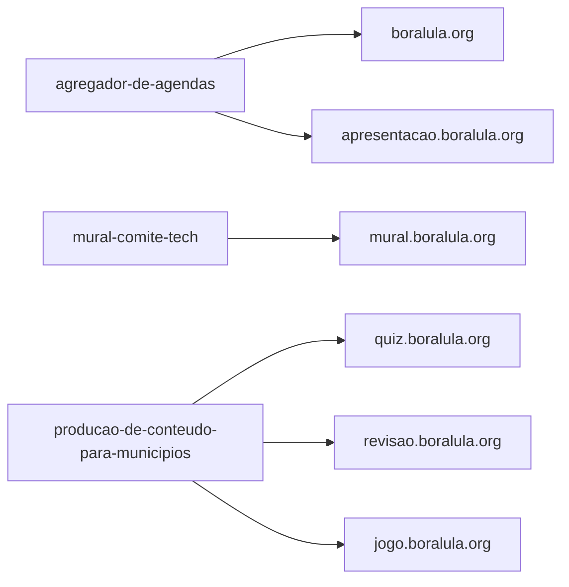

# Comitê Popular de Tecnologia

Voluntários de tecnologia construindo ferramentas para o Comitê Popular: agendas de eventos, conteúdo para municípios, sites e a infraestrutura que mantém tudo no ar.

## Quero ajudar: entre pelo Mural

**[Abrir o Mural do Comitê Tech →](https://mural.boralula.org/)**

O Mural é a porta de entrada. Se você ainda não está em nenhum GT, comece sempre por ele, e não por aqui. No Mural você escolhe onde ajudar pelo que sabe fazer:

- **Vagas:** filtre por tema e habilidade e clique em *Tenho interesse*. A coordenação do GT te chama no WhatsApp.
- **GTs:** veja os grupos de trabalho, oficiais e da comunidade, e o canal de cada um.
- **Ideias:** proponha uma ideia ou marque que quer participar de uma.

Você entra com a conta Google e preenche um perfil curto, com o WhatsApp para a coordenação te chamar.

## Como o boralula.org é feito

Cada endereço do boralula.org sai de um repositório. Para mexer num deles, peça acesso à iniciativa daquele repositório (pedido 1, abaixo).

Em geral, a mudança chega assim: o PR é revisado e entra na branch principal, os testes rodam, o ambiente de dev é publicado sozinho e a produção é publicada por quem cuida da frente. O detalhe de cada um fica no README do repositório.

## Já está num GT? Três pedidos, um para cada passo

Os pedidos são de autoatendimento: você abre pelo GitHub, sem ninguém editar configuração à mão. Cada um acompanha um passo do seu envolvimento, e ninguém precisa passar por todos: entre direto na etapa que você já vive.

| Passo | Pedido | Quem aprova |
|---|---|---|
| Entrei num GT | [1. Acesso aos repositórios](#1-peça-acesso-aos-repositórios) | O núcleo da iniciativa |
| O GT vai construir algo | [2. Repositório ou iniciativa nova](#2-peça-um-repositório-ou-uma-iniciativa-nova) | Um admin da org |
| Cuido da frente | [3. Entrada no núcleo](#3-pôr-alguém-no-núcleo-acesso-de-escrita-com-muito-cuidado) | Um admin da org, com muito cuidado |

Nos três, a sua issue fecha na hora e recebe um comentário com o link do pedido. Se você não conseguir abri-lo, é normal: mande o link para quem aprova.

### 1. Peça acesso aos repositórios

**[Peça acesso a uma iniciativa →](https://github.com/comite-popular-tech/voluntariado/issues/new?template=pedido-de-acesso.yml)**

1. Abra o pedido com a conta do GitHub que você vai usar e escolha a iniciativa.
2. O núcleo da iniciativa avalia o pedido. Mande o link do pedido para alguém do núcleo.
3. Aprovado, chega no seu e-mail um convite do GitHub para entrar na org. Aceite o convite para ver os repositórios da iniciativa.

### 2. Peça um repositório ou uma iniciativa nova

**[Peça um repositório novo →](https://github.com/comite-popular-tech/voluntariado/issues/new?template=novo-repositorio.yml)**

O pedido sai de uma conversa dentro do GT: o grupo combina o que vai construir e alguém abre o pedido. Sem GT, o pedido não anda. Volte ao Mural e entre num grupo primeiro.

No pedido, escolha a iniciativa do repositório, ou "nova" para criar uma iniciativa, que começa com os times vazios. Um admin da org avalia o pedido. Mande o link do pedido para um admin.

### 3. Pôr alguém no núcleo: acesso de escrita, com muito cuidado

**[Peça a entrada de alguém no núcleo →](https://github.com/comite-popular-tech/voluntariado/issues/new?template=membro-do-nucleo.yml)**

> [!CAUTION]
> Quem está no núcleo dá push na `main`, publica e lê os segredos dos repositórios da frente. Só peça para quem o núcleo da frente já conhece e confia.

Qualquer pessoa pode pedir, para si ou para outra, informando o usuário do GitHub e a frente. O pedido vira um PR que um admin da org só junta depois de conferir:

- se foi a própria pessoa que pediu;
- se o núcleo da frente conhece a pessoa e confirmou;
- se a conta do GitHub é mesmo dela;
- se a verificação em duas etapas está ligada.

Na dúvida, o pedido não entra.

## Quem pode ajudar

Travou num pedido, num acesso ou num merge? Fale com uma destas pessoas:

- Gabriel
- Kadu ([@kaducovas](https://github.com/kaducovas))
- Guilherme ([@guipfranco](https://github.com/guipfranco))
- Filipe ([@fbaetalab](https://github.com/fbaetalab))
- Moreto ([@the-zokai](https://github.com/the-zokai))
- Gomex ([@gomex](https://github.com/gomex))
- Pirola ([@lpirola](https://github.com/lpirola))
- Alê ([@aleboava](https://github.com/aleboava))

## Iniciativas

| Iniciativa | Do que cuida |
|---|---|
| `agenda` | Agenda de eventos: coleta, revisão e publicação dos eventos |
| `conteudo` | Produção de conteúdo para municípios |
| `mural` | [Mural](https://mural.boralula.org/) de vagas, GTs e ideias para os voluntários |
| `infra-sec` | Infraestrutura e segurança de todas as iniciativas |
| `hub` | Hub |
| `virometro` | Virômetro: registro de votos virados |
| `barra-cpl` | Barra CPL |

## Como trabalhamos

- **Os repositórios são privados.** Cada pessoa vê os da própria iniciativa.
- **Voluntários contribuem por fork e pull request.** O núcleo da iniciativa revisa e junta.
- **Ative a autenticação em dois fatores** na sua conta do GitHub antes de pedir acesso.
- **Nada de dados pessoais em issues públicas:** nem telefone, nem e-mail, nem endereço.
